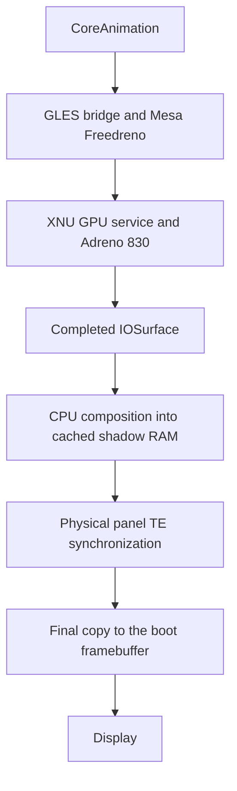

# ios-dodge: delay, rendering and responsiveness changes

**Device:** OnePlus 13 / SM8750 / Adreno 830  
**System:** iOS 16.5 / 20F66  
**Snapshot:** 29 October 2026  
**Selected build:** `experimental/screen-brightness/control-v2/payload.bin`

This report documents the changes used to improve the port's responsiveness, graphics correctness and presentation. It distinguishes code integrated from the supplied GLES v3 sources, local adaptations, existing behavior retained from the port, and experiments that were rolled back.

The user confirmed usable scrolling, hardware-rendered iOS, working brightness, battery and slider behavior. A small amount of app-dismiss tearing remains. **There is no controlled before/after latency benchmark or verified 120 FPS result.** Individual speedup percentages cannot be assigned to these changes.

## 1. Complete change summary

| Area | Change | Role in the current build |
| --- | --- | --- |
| GPU renderer | Integrated the matched Adreno 830 kernel, GLES bridge and Mesa/Freedreno stack from the supplied GLES v3 archive. | Hardware GLES rendering is active and runtime-verified. |
| GPU initialization | Retained the donor's matching GMU, HFI, command submission, context, SMMU and secure-resource setup. | Allows real GPU execution rather than merely exposing a renderer name. |
| GPU memory | Integrated buffer objects, physical-backing import and IOSurface sharing. | Gives the renderer and display a compatible memory path. |
| Mesa | Preserved the paired Mesa 26.2.5 patch set, including Darwin/DRM, OSMesa and Freedreno/Gen8 adaptations. | Keeps userland compatible with the XNU GPU service. |
| GLES compatibility | Retained CoreAnimation compatibility handling and added the narrow untextured `GL_LINES` glyph exception. | Fixes missing labels while retaining protection against white full-screen draws. |
| Kernel concurrency | Replaced shared device-tree traversal state with a per-call cursor; initialized immutable board matching before concurrent GPU clients. | Prevents concurrent searches from corrupting each other or panicking. |
| GPU completion | Retained GPU completion/fence checks; discard an unfinished frame rather than reading it for display. | Prevents incomplete GPU images from being presented. |
| Submission overlap | Retained the asynchronous framebuffer presenter and `RedwoodWaitsForGPU` agreement with the GLES bridge. | Moves necessary completion waiting to the presenter, allowing rendering/submission overlap. |
| CPU composition | Preserved the inherited three-worker scaler and moved its output to a cached full-frame shadow buffer. | Keeps parallel scaling away from active scanout. |
| Display presentation | Copy the complete shadow frame after an observed panel TE edge; retain the queue slot until the copy finishes. | Greatly reduces horizontal tearing and inconsistent presentation. |
| Background CPU use | Changed the flashlight worker's normal waits to scheduler sleeps, including a 20 ms control-loop interval. | Avoids continuously consuming CPU while waiting between checks. |
| Screen-brightness work | Use a sleeping kernel worker and an approximately 100 ms system-brightness poll; send only changed levels. | Adds brightness support without continuously repainting or dimming the framebuffer. |
| CPU layout | Use seven iOS cores, with physical CPU0 reserved for firmware USB. | Preserves live logs and reboot access; it is a support/stability choice, not an eight-core performance optimization. |
| GPU debug pause | Set the compiled `adreno8_pause_ms` default to zero, matching the earlier effective `adreno8_pause=0` setting. | Preserves an already-disabled startup pause; no additional measured speedup is claimed. |
| Wallpaper services | Enable required catalog services and use a scoped CoreGraphics preview fallback. | Avoids a failed Metal-only preview path and associated crashes/blank UI. |
| Build reliability | Use separate work directories for different source trees, verify generated dependencies and embedded feature markers. | Ensures the intended fixes actually reach the kernel and payload. |
| Failed display experiment | Rolled back the nonpreemptible-copy candidate after a button failure report. | The saved brightness build remains selected, and the user confirmed all buttons work again. |
| 120 FPS experiments | Kept unsuccessful timing/opt-in experiments out of the selected profile. | The current build does not depend on an unverified 120 FPS fix. |

## 2. The actual rendering pipeline



The GPU accelerates the GLES rendering path. The CPU still scales/composes surfaces and performs the final display copy. This is **not hardware page flipping or a completely CPU-free display pipeline**.

The use of an OSMesa frontend does not, by itself, establish software rendering. The relevant evidence is the selected backend and successful GPU execution. Live CoreAnimation logs reported:

```text
OpenGL ES 3.2 Mesa 26.2.5; Adreno (TM) 830
```

GPU command/context tests and the interactive scrolling check provide additional evidence beyond that renderer string.

## 3. Adreno 830 integration

### 3.1 Matched kernel and userland

The user supplied `OnePlus13-GLES-v3-Sources-20261028-191401.tar.7z`. The archive was checked locally: 18,825 regular-file hashes and 10 tar symlinks were verified.

The adaptation integrated the matched components together:

- Adreno initialization and clock/resource handling.
- GMU startup and HFI communication.
- GPU command submission and HWSCHED support.
- Context creation and associated secure-resource handling.
- SMMU mappings, buffer objects and imported surface backing.
- The XNU GPU service/user-client interface.
- The paired GLES/OSMesa bridge and Mesa library.

These components came substantially from the supplied donor port. They were integrated and adapted to this OnePlus 13 workspace; they were not all newly written during this session.

Mixing unrelated kernel and Mesa interfaces would risk incompatible buffer, mapping or submission behavior. The matched stack was retained while preserving the working battery, touch, slider and USB profile.

**Sources:** [GPU initialization][adreno], [GPU implementation directory][gpu-dir], [GPU service][gpu-service], [GPU validation][gpu-validation].

### 3.2 Memory and surface sharing

The imported stack supplies the buffer allocation, physical-backing import, GPU mapping and IOSurface support needed by the renderer. The display waits for the GPU to complete a surface before reading it.

If a surface does not become ready within the failure timeout, the swap is dropped and the displayed frame is retained. The `SWAP_GPU_MS = 500` value is a failure timeout, **not a mandatory 500 ms wait for every frame**.

**Sources:** [GPU memory handling][gpu-memory], [IOSurface support][iosurface], [framebuffer presenter][framebuffer].

### 3.3 Conservative GPU speed

The selected command line includes `adreno8_speed=1`. In this port that selects the donor-tested 160 MHz setting. It does not enable maximum clocks or overclock the GPU.

The responsiveness improvement primarily comes from using functioning hardware rendering and compatible presentation, not from forcing the highest GPU frequency.

### 3.4 Effective GPU profile

These settings describe the selected runtime profile; several were retained from the working donor integration rather than introduced as new speed tweaks.

| Setting | Selected value / meaning |
| --- | --- |
| `gl=1` | Select the GLES rendering path. |
| `metal=0` | Keep unsupported Metal rendering disabled. |
| `adreno8=23` | Run the matched GPU initialization profile through stage 23. |
| `adreno8_keep=1` | Retain GPU resources while iOS runs. |
| `adreno8_secure_preflight=4` | Use the matched secure-resource preparation profile. |
| `adreno8_speed=1` | Retain the conservative 160 MHz GPU setting. |
| `adreno8_watch=0` | No timed GPU watch/return profile is requested. |
| `loader_return_after=0` | Do not impose a timed return from iOS to the loader. |

GPU-owned/protected memory must not be reused by starting another GPU session in the same loader state. The retained ownership guards and cold-reset workflow prevent unsafe reuse. This is a stability measure, not a claimed per-frame speed improvement.

## 4. Mesa, Freedreno and the GLES bridge

### 4.1 Paired Mesa 26.2.5 source

The repository contains a consolidated patch and a changed-file hash manifest for the exact upstream Mesa 26.2.5 release used by the donor integration.

The patch includes:

- Darwin DRM/OSMesa support for this environment.
- Restored OSMesa frontends required by the Mesa 26 build.
- Freedreno/Gen8 adaptations used by the Adreno stack.
- Shared GL API/bridge support.
- Source needed by the donor build graph, including AIR-related source. **Its presence does not mean Metal is enabled.**

All 59 changed/new text files were reconstructed and checked against the manifest. Those 59 files include build files and documentation; they are not 59 independently measured performance fixes.

Apply the consolidated patch once. Do not additionally apply the historical Mesa patches to the same prepared tree.

**Sources:** [Mesa integration notes][mesa-readme], [complete 59-file manifest][mesa-manifest], [consolidated patch][mesa-patch].

### 4.2 CoreAnimation's GLES route

The existing userland injection selects the OpenGL ES route and loads the matching bridge. The selected profile uses `gl=1` and `metal=0`.

The bridge translates the required rendering behavior into the supported GLES/Mesa path. Existing compatibility code handles cases such as framebuffer fetch, vibrancy, grouped layers and shader behavior. These are inherited/adapted port mechanisms, not a claim that every iOS rendering feature is supported.

**Sources:** [window-server integration][inject], [GLES bridge][eagl].

### 4.3 Glyph-spans correction

CoreAnimation can draw glyph spans using untextured `GL_LINES` with program zero. The narrow exception in `plain_draw_begin()` allows those spans, preventing missing icon labels.

The exception is limited to lines. Untextured full-screen triangles remain rejected where required, avoiding an earlier white-screen/overdraw failure mode.

This is a rendering-correctness fix. It has no separately measured FPS improvement.

## 5. CPU and kernel concurrency

### 5.1 Device-tree traversal

The old traversal used shared static search state. Concurrent GPU/display clients could move each other's cursor out of the device-tree region and cause a panic.

The integrated fix passes a cursor belonging to each search through the recursive traversal. This is per-call state, not a global cursor.

### 5.2 Board matching before concurrent clients

`oneplus_gpu_platform_init()` checks the immutable board identity during initialization and publishes a cached result. Submission and framebuffer threads read that result rather than repeatedly walking the device tree.

These changes improve correctness under concurrent GPU clients. There is no isolated benchmark showing a specific number of milliseconds saved by caching the lookup.

**Sources:** [device-tree traversal][device-tree], [platform initialization][platform].

### 5.3 Seven iOS cores and one firmware core

The selected profile uses:

| Setting | Purpose |
| --- | --- |
| `cpus=7` | Seven cores are assigned to iOS. |
| `bootcpu=1` | iOS starts on physical CPU1. |
| `gicr_stride=0x40000` | Port-specific interrupt-controller layout. |
| `op13_usb=1` | Retains the native battery/live-USB profile. |
| `cpufreq=0` | Does not enable the experimental CPU-frequency programming path. |

Physical CPU0 remains in firmware for USB diagnostics. All seven requested iOS CPUs were observed running. The missing eighth iOS CPU is intentional; this is not evidence of an undetected failed core.

An earlier eight-core software-renderer profile exists as a fallback, but does not provide the same live firmware USB access. No all-core turbo, CPU overclock or per-core performance gain is claimed.

## 6. CPU composition and display presentation

### 6.1 Three scaler workers: retained behavior

The framebuffer already defaults to `fb_threads=3`. That parallel scaler was inherited from the port and preserved. The upstream source comment describes an older device test, but its historical timing is not a new benchmark from this session.

The adaptation moved scaling/clear writes away from active scanout, rather than claiming that the three-worker scaler was newly invented here.

### 6.2 Cached full-frame shadow

Previously, scaler workers could write different bands directly into the framebuffer being scanned by the display. That exposed partially updated frames.

The retained anti-tear implementation:

1. Allocates a cached full-frame shadow for the 1440 × 3168 panel: approximately 17.4 MiB, or 18.2 MB, at four bytes per pixel.
2. Directs scaling and clear operations into the shadow.
3. Waits until composition is complete.
4. Copies the completed frame to the active framebuffer in one final row-copy pass.

This is shadow buffering followed by a copy, not an atomic framebuffer flip.

### 6.3 Physical TE synchronization

The final copy waits for the panel's physical TE signal, identified as GPIO86. The code reads its configuration/input and does not change the pin mux.

The policy calibrates a TE period, sleeps until approximately 750 microseconds before the predicted edge, then polls for the actual rising edge. Waiting is bounded; repeated timeouts disable TE waiting rather than hanging indefinitely.

The old free-running software beat is bypassed when shadow presentation is active. The swap queue slot is held until the final copy completes, so the queue does not advertise completion before display copying finishes.

### 6.4 What was observed

Earlier captures measured approximately 8,290 microseconds between TE edges and final-copy durations of roughly 1.1–2.9 ms. The latest saved boot measured an 8,291 microsecond TE period and a maximum sampled copy of 2,868 microseconds.

Those copies fit within the observed panel period. This does not prove that copying is atomic, that every possible animation is tear-free, or that applications render at 120 FPS. The user later reported a small split during app dismissal, then described the residual tearing as minor and almost gone.

**Sources:** [presentation policy][commit-policy], [framebuffer implementation][framebuffer], [display validation][display-validation].

## 7. GPU completion and queueing

The retained `RedwoodWaitsForGPU` property tells the GLES bridge that the framebuffer presenter performs the required completion wait. This permits the rendering side to progress to the next frame rather than imposing an unnecessary synchronous finish at every handoff.

The presenter still checks completion before reading pixels. Avoiding a redundant wait does not mean bypassing GPU synchronization.

The inherited default queue permits two waiting swaps. It is bounded rather than allowing an unlimited backlog. The current integration retains its existing behavior and holds a queue slot through the final display copy.

These mechanisms support overlap between rendering and presentation, but the session did not separately measure their input-to-photon latency contribution.

## 8. Background CPU use

### 8.1 Flashlight worker

The native PM8550 flashlight adaptation replaced ordinary millisecond busy waits with scheduler-backed sleeps. Its control loop sleeps for 20 ms between iterations instead of continuously spinning.

Hardware transaction polling still has short bounded waits where required. Shutdown handling retains its special busy-wait path. The change is specifically about normal background waiting, not removing every polling loop in the kernel.

This avoids occupying CPU simply to wait between flashlight checks. No per-core utilization percentage was measured, and no precise battery-life improvement is claimed.

The four-channel hardware setup, temperature/fault checks and 30-second activation cutoff are functionality/safety behavior, not additional FPS optimizations.

**Source:** [native flashlight worker][torch].

### 8.2 Screen-brightness workers

The brightness agent polls the system value approximately every 100 ms and writes only changed levels. The kernel worker sleeps between checks and sends native DCS51 brightness commands.

It does not apply a per-frame pixel-darkening pass, redraw the framebuffer continuously, or change the display mode to implement brightness. This prevents the new feature from adding that kind of rendering workload; it is not a measured standalone scrolling speedup.

**Sources:** [brightness agent][brightness-agent], [kernel brightness worker][brightness-kernel], [brightness guide][brightness-guide].

## 9. Startup delays: an important correction

### 9.1 The 2.2-second GPU debug pause

The GPU source originally defaulted `adreno8_pause_ms` to `2200`. The working GLES profile already supplied `adreno8_pause=0`, so its effective pause was already disabled.

During flashlight integration the compiled default was changed to zero. The redundant command-line argument could then be removed to make room for `torch=3` within the loader's command-line limit.

**This preserved the previous effective setting. It is not evidence that the later change independently removed another 2.2 seconds from an already-working boot.** It also does not establish an ongoing per-frame speedup.

### 9.2 The ALS startup wait was not disabled

An older `brightness_fixes()` helper can bypass an ambient-light-sensor arrival wait. It remains disabled because earlier attempts interfered with the timing of touch-service discovery.

The working screen-brightness fix uses the native panel command path instead. The retained ALS wait must not be listed as a successfully removed delay.

**Sources:** [GPU settings][adreno], [window-server initialization][inject].

### 9.3 RAM upload time remains

Booting still transfers the payload and the approximately 2.49 GB Sileo system image into RAM. USB upload time is separate from scrolling latency once iOS runs.

The last boot loaded the existing saved build. It did not introduce a new optimization. Cleaning caches on the Mac was a storage cleanup and is not a claimed fix for the phone's UI delay.

## 10. Related UI failures that could look like delay

### Wallpapers and previews

Required catalog services were enabled on demand. A scoped CoreGraphics preview implementation replaces the verified Metal-only capture path that failed in PosterBoard. This made wallpaper selection through Settings usable.

Lock-screen long-press wallpaper selection remains guarded because its hosted scene still has an unresolved black-screen problem. Disabling that broken entry avoids the failure; it does not mean that picker was fixed.

**Source:** [wallpaper preview integration][wallpaper].

### Brightness controls

Native DCS51 support fixed actual panel dimming. A scoped `_canAdjustBrightness` override enabled the previously stuck Control Center handle. These are functionality fixes, not synthetic animation or FPS changes.

### Blur and vibrancy

The project contains inherited blur/vibrancy compatibility mechanisms, and the user previously associated a slowdown with dock blur. The saved evidence does not support claiming that every blur effect was removed or that a specific dock-blur patch independently accounts for the current improvement.

The software-renderer-only `plain_vibrancy()` behavior is not a universal blur-off switch for the active GPU profile. No new blanket blur-removal change was made during the latest brightness/boot work.

## 11. Experiments excluded from the current build

### Nonpreemptible final-copy experiment

An `anti-tear-v2` candidate attempted to protect the final copy against scheduling preemption and reject a late start after TE. It passed host tests and booted, but the user later reported that power and volume buttons stopped working while it was running.

The saved brightness build was restored. The user confirmed Power, Volume Up and Volume Down worked again. The button driver sources were identical between the two builds, so the precise cause was not established.

The candidate is **not selected**, and its nonpreemptible-copy change was excluded from the published active kernel. It is not listed as a completed delay fix.

### 120 FPS / timing overrides

Experiments adjusted advertised refresh timing, CoreAnimation timing fields and app opt-in behavior. A measured panel TE near 120 Hz and a reported maximum refresh rate were not accepted as proof of application cadence.

The investigation did not establish working 120 FPS application presentation. The user stopped FPS work. The selected framebuffer still advertises 60 Hz, and the unsuccessful timing helpers are not part of the selected brightness profile.

## 12. Build and validation changes

An early flashlight build reused a work directory created for a different source tree. Generated dependency files retained the old absolute paths, so an old single-channel object reached the payload despite the edited source.

The corrected workflow uses:

- A unique build work directory when changing source checkouts.
- Dependency-path checks for the intended source tree.
- Unique feature markers checked in objects, linked kernels and live logs.
- Fresh packaging outputs rather than overwriting the selected fallback.
- APFS readback verification of regular files after rebuilding the RAM root/system.
- Explicit payload, kernel, firmware-loader and system-image hashes.

These are delivery/reliability fixes: they establish which code was tested. They do not increase runtime FPS directly.

Verified checks include:

| Check | Recorded result |
| --- | --- |
| GPU execution | Renderer, command/context tests and user-confirmed usable scrolling. |
| CPU participation | All seven requested iOS CPUs running. |
| Stable display policy | 1,187 sanitizer frame-copy/TE timing cases passed. |
| Live reset dispatch | 192 sanitizer cases passed. |
| DSI brightness | Packet format, range limits, W1C preservation, state restoration and rejection paths passed. |
| Other regressions | USB reconnect, console overlay, slider and battery wire checks passed. |
| Published feature RAM root | All 540 regular files verified by readback. |
| Source-only builds | Kernel, UEFI, GLES bridge and brightness helpers compiled. |

Raw logs and personal device calibration remain local. The source-only repository rebuild is not claimed byte-identical to the historical phone kernel; gated unfinished audio diagnostics from the local workspace were intentionally excluded from publication.

**Source:** [sanitized source-check results][source-checks].

## 13. Selected profile and remaining limits

| Component | Current local artifact |
| --- | --- |
| Payload | `experimental/screen-brightness/control-v2/payload.bin` |
| UEFI | `experimental/uefi-turtle/screen-brightness-v13/dodge-ios-uefi.img` |
| System | `experimental/sileo/v1/system-sileo.apfs` |
| Renderer | Adreno 830 / Mesa 26.2.5 / OpenGL ES 3.2 |
| iOS CPU layout | Seven iOS cores; firmware USB on CPU0 |
| Presentation | Cached shadow, physical TE wait, CPU copy to scanout |

Remaining limits:

- Minor app-dismiss tearing can still occur.
- Metal is disabled, and 120 FPS application rendering is unverified.
- There is no controlled touch-latency or per-change FPS benchmark.
- Sustained thermal, power and long-term stability behavior needs more testing.
- Wi-Fi and sound remain unfinished; they are not claimed fixed by the GPU work.
- The current GPU profile intentionally retains the conservative 160 MHz setting.
- Live firmware USB is not an iOS SSH/filesystem shell.

All phone boots and tests used RAM boot/staging. No phone partition flashing or erasing was used for these changes.

## 14. Attribution and source map

The major GPU/Mesa/GLES components were integrated from the supplied OnePlus 13 GLES v3 archive, with the donor provenance documented in the repository. The local work combined that stack with the existing port, retained/fixed concurrency and presentation behavior, added native flashlight/brightness adaptations, and validated the resulting profiles.

For exact upstream pins, license boundaries and changed-file hashes, see [SOURCE-PROVENANCE.md][provenance] and the [Mesa source manifest][mesa-manifest].

[adreno]: https://github.com/faridbtw/ios-dodge/blob/main/source/xnu-build-snapshot/xnu-8796.121.2/bsd/dev/adreno8.c
[gpu-dir]: https://github.com/faridbtw/ios-dodge/tree/main/source/xnu-build-snapshot/xnu-8796.121.2/bsd/dev
[gpu-service]: https://github.com/faridbtw/ios-dodge/blob/main/source/xnu-build-snapshot/xnu-8796.121.2/iokit/Kernel/RedwoodGPU.cpp
[gpu-validation]: https://github.com/faridbtw/ios-dodge/blob/main/validation/gpu-gles/STATUS.json
[gpu-memory]: https://github.com/faridbtw/ios-dodge/blob/main/source/xnu-build-snapshot/xnu-8796.121.2/iokit/Kernel/RedwoodGPUMemory.inc
[iosurface]: https://github.com/faridbtw/ios-dodge/blob/main/source/xnu-build-snapshot/xnu-8796.121.2/iokit/Kernel/MiniIOSurface.cpp
[framebuffer]: https://github.com/faridbtw/ios-dodge/blob/main/source/xnu-build-snapshot/xnu-8796.121.2/iokit/Kernel/MiniIOMobileFramebuffer.cpp
[mesa-readme]: https://github.com/faridbtw/ios-dodge/blob/main/source/mesa26-op13/README.txt
[mesa-manifest]: https://github.com/faridbtw/ios-dodge/blob/main/source/mesa26-op13/SOURCE-MANIFEST.json
[mesa-patch]: https://github.com/faridbtw/ios-dodge/blob/main/source/mesa26-op13/mesa-26.2.5-op13.patch
[inject]: https://github.com/faridbtw/ios-dodge/blob/main/source/hackios-xnu-userland/userland/src/inject.c
[eagl]: https://github.com/faridbtw/ios-dodge/blob/main/source/hackios-xnu-userland/userland/src/eagl.c
[device-tree]: https://github.com/faridbtw/ios-dodge/blob/main/source/xnu-build-snapshot/xnu-8796.121.2/pexpert/gen/device_tree.c
[platform]: https://github.com/faridbtw/ios-dodge/blob/main/source/xnu-build-snapshot/xnu-8796.121.2/bsd/dev/k90_oneplus_gpu.c
[commit-policy]: https://github.com/faridbtw/ios-dodge/blob/main/source/xnu-build-snapshot/xnu-8796.121.2/iokit/Kernel/MiniFramebufferCommit.h
[display-validation]: https://github.com/faridbtw/ios-dodge/blob/main/validation/display/STATUS.json
[torch]: https://github.com/faridbtw/ios-dodge/blob/main/source/xnu-build-snapshot/xnu-8796.121.2/bsd/dev/redwood_torch.c
[brightness-agent]: https://github.com/faridbtw/ios-dodge/blob/main/source/screen-brightness/brightness.c
[brightness-kernel]: https://github.com/faridbtw/ios-dodge/blob/main/source/xnu-build-snapshot/xnu-8796.121.2/bsd/dev/op13_screen.c
[brightness-guide]: https://github.com/faridbtw/ios-dodge/blob/main/source/screen-brightness/README.txt
[wallpaper]: https://github.com/faridbtw/ios-dodge/tree/main/source/wallpaper-preview
[source-checks]: https://github.com/faridbtw/ios-dodge/blob/main/validation/20261029-source-checks.json
[provenance]: https://github.com/faridbtw/ios-dodge/blob/main/SOURCE-PROVENANCE.md
