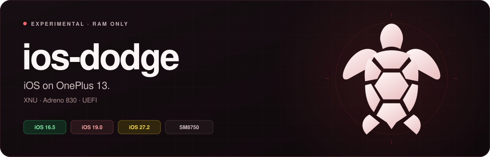

<p align="center">
  
</p>

<p align="center">
  <strong>OnePlus 13</strong> &nbsp; / &nbsp; <strong>iOS 27.2 · 24B119</strong>
</p>

<p align="center">
  <a href="QUICKSTART.txt">Quick start</a> &nbsp; · &nbsp;
  <a href="#feature-status">Feature status</a> &nbsp; · &nbsp;
  <a href="BUGLIST.txt">Bug list</a> &nbsp; · &nbsp;
  <a href="source/ios27/README.md">Build guide</a> &nbsp; · &nbsp;
  <a href="SOURCE-PROVENANCE.md">Sources &amp; credits</a>
</p>

---

Experimental **iOS 27.2 / 24B119** bring-up for **OnePlus 13 (`dodge`, SM8750)**. This branch preserves its native Metal UI, battery, wallpaper-display and status-bar work. Source and sanitized results are included; generated boot files and Apple runtime images stay local.

> **RAM only.** Use `fastboot boot` and temporary staging. Never flash or erase phone partitions. System images, firmware, SDKs, device calibration and raw logs stay local.

## Feature status

This table describes the selected **iOS 27.2 `status-layout-v4` profile**, using its verified battery kernel. It is based on [iOS27 validation](validation/ios27/STATUS.json), not the iOS16 feature set.

| Feature | iOS 27.2 status |
| :--- | :--- |
| **Boot and touch** | Native lock/home screen and touch tested; seven iOS cores, one retained firmware USB core. |
| **Adreno 830 / Metal** | Arm64e Vulkan/Metal standalone probes passed. Native EDR/InputUI startup improved interface responsiveness; 60/120 FPS is not established. |
| **Battery** | Native battery reporting and charging/unplug/reconnect transitions verified in the recorded test. |
| **Wallpaper display** | Stock wallpaper displays through the native Metal providers; user-confirmed. |
| **Dynamic Island / battery placement** | User-confirmed alignment and battery position. |
| **Status-bar clock** | Still missing after native timer restart. |
| **Wallpaper selection** | Unfinished; gallery attempts can fail or respring. |
| **Wi-Fi** | Disabled in this iOS27 profile. |
| **Sound** | Unverified; Voice Memos was reported to freeze. |

### Still in progress

Startup/animation black bands and blank widgets remain. Broad app compatibility and sustained rendering performance are unverified. A CPU-governor trial was rejected for worse responsiveness and is not selected. A shutdown panic was captured after `oem stop`; use a cold reboot before another GPU/DSP session.

The iOS16 Wi-Fi/Sileo/flashlight/slider results and the newer iOS19 fixes do not establish those features in this iOS27 profile. See [BUGLIST.txt](BUGLIST.txt) and [graphics/performance notes](source/ios27/PERFORMANCE.md).

## Get started

A prepared local workspace is required. The selected matching files are:

| Local artifact | Path inside the original workspace |
| :--- | :--- |
| UEFI | `experimental/ios27/v2/dodge-ios-uefi.img` |
| Payload | `experimental/ios27/v2/status-layout-v4/payload.bin` |
| Boot RAM image | `experimental/ios27/v2/status-layout-v4/boot.apfs` |
| System RAM image | `experimental/ios27/v2/system-registration-test.apfs` |

These are local build outputs, not repository downloads. Start Android, authorize USB debugging and connect the phone. In the owner's prepared workspace, run:

```sh
/opt/homebrew/bin/python3 ~/Documents/Porting/OnePlus13-iOS-RAM/experimental/ios27/v2/boot-ios27.py
```

That runner uses the matching local preflight profile, boots UEFI with `fastboot boot`, uploads the system into RAM and starts iOS. Keep USB connected through upload. A cold reboot loses the RAM session.

[QUICKSTART.txt](QUICKSTART.txt) covers boot/recovery. [Source and build notes](source/ios27/README.md) describe the required local inputs and source layout. This is a source snapshot rather than a complete one-command image builder.

## Repository layout

| Folder | What you’ll find |
| :--- | :--- |
| [Source](source/) | Kernel, UEFI, graphics and native platform adaptations. |
| [Tools](tools/) | Build, packaging, boot and regression helpers. |
| [Validation](validation/) | Results scoped to each tested build. |
| [Documentation](docs/) | Guides, source credits and archived instructions. |
| [Assets](assets/) | Banner and boot artwork. |
| [Hardware references](diagnostics/) | Vendor protocol source references. |
| [Integration helpers](experimental/) | Source scripts for staged bring-up. |

## Branches and sources

- [iOS16](https://github.com/faridbtw/ios-dodge/tree/iOS16): iOS16.5 baseline and its own feature status.
- [iOS19](https://github.com/faridbtw/ios-dodge/tree/iOS19): Solarium iOS19.0 Internal bring-up.
- **iOS27**: this branch, iOS27.2 / 24B119.

Inherited source licenses are retained. See [sources and credits](SOURCE-PROVENANCE.md).
